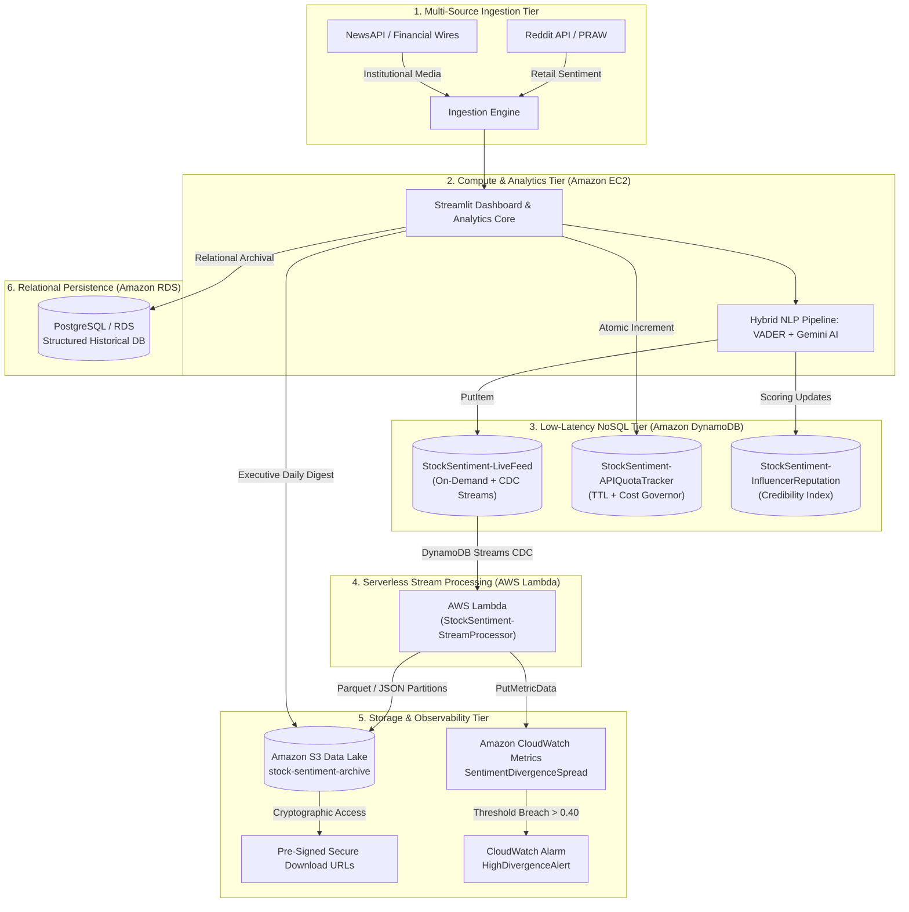

# 📈 Stock Sentiment Analyser & Financial Market Intelligence Platform
### Enterprise Cloud Architecture on Amazon Web Services (AWS)

[-orange?logo=amazon-aws)](https://aws.amazon.com/)
[](https://www.python.org/)
[](https://streamlit.io/)
[](https://aws.amazon.com/dynamodb/)
[](https://aws.amazon.com/lambda/)
[](https://aws.amazon.com/s3/)
[](https://aws.amazon.com/cloudwatch/)

---

## 👨‍🎓 Author & Academic Profile

- **Student Name:** Aadhitya Ayyappan
- **Register Number:** 24BAI1080
- **Institution:** Vellore Institute of Technology (VIT), Chennai
- **Project Domain:** Cloud Computing, Distributed Big Data Systems, Financial Natural Language Processing (NLP)

---

## 🏛️ Executive Summary & Overview

Modern financial markets suffer from acute informational asymmetry. While retail investors voice immediate, sentiment-rich speculation across decentralized social media channels (e.g., Reddit r/wallstreetbets, r/IndianStockMarket), institutional market participants communicate via regulated journalistic feeds and financial news wires (NewsAPI).

The **Stock Sentiment Analyser** is an enterprise-grade cloud analytics platform built natively on **Amazon Web Services (AWS)**. It ingests, analyzes, and correlates streaming unstructured text from both retail and institutional feeds in real time. Powered by a hybrid NLP engine combining **VADER sentiment analysis** and **Google Gemini Generative AI**, the platform detects market divergences, tracks influencer reputation, manages external API consumption, and dispatches automated cloud alerts.

---

## 🌐 Cloud Architecture Diagram



---

## ☁️ AWS Cloud Services Implementation

| AWS Service | Architecture Role & Technical Implementation |
|---|---|
| **Amazon EC2** | Hosts the real-time Streamlit analytics engine and data collection daemons inside an Amazon VPC with dedicated security groups. |
| **Amazon DynamoDB** | Ultra-low latency NoSQL database operating in **On-Demand (Pay-Per-Request)** mode across 3 dedicated tables: Live sentiment telemetry, API quota management, and influencer credibility. |
| **DynamoDB Streams** | Change Data Capture (CDC) engine emitting real-time event records (`NEW_IMAGE`) whenever sentiment records are written. |
| **AWS Lambda** | Serverless event processor (`StockSentiment-StreamProcessor`) executing automated correlation, divergence scoring, and event forwarding. |
| **Amazon S3** | Partitioned cloud data lake (`stock-sentiment-archive-136127964165`) storing raw JSON/Parquet historical archives and executive sentiment digests secured with cryptographic **Pre-Signed URLs** (1-hour TTL). |
| **Amazon CloudWatch** | Real-time observability: Custom metrics (`SentimentDivergenceSpread`), alarm monitoring (`StockSentiment-HighDivergenceAlert`), and serverless execution logs. |
| **Amazon RDS** | Relational persistence for structured historical sentiment tables, relational queries, and cross-session persistence. |
| **AWS IAM** | Role-based least-privilege security policies isolating EC2 execution profiles, Lambda execution roles, and S3 bucket policies. |

---

## 📊 DynamoDB NoSQL Data Architecture

The platform provisions three distinct DynamoDB tables tailored for specific access patterns:

1. **`StockSentiment-LiveFeed`**
   - **Primary Key:** Partition Key `ticker` (String), Sort Key `timestamp` (String)
   - **Features:** DynamoDB Streams enabled (`NEW_AND_OLD_IMAGES`), On-Demand billing.
   - **Purpose:** Stores incoming granular post records, VADER compound polarity scores, and classification tags.

2. **`StockSentiment-APIQuotaTracker`**
   - **Primary Key:** Partition Key `apiProvider` (String), Sort Key `requestDate` (String)
   - **Features:** Atomic integer counters (`ADD totalRequests 1`), automatic monthly cost forecasting.
   - **Purpose:** Protects external API budgets (Reddit, NewsAPI) from rate limits and overages.

3. **`StockSentiment-InfluencerReputation`**
   - **Primary Key:** Partition Key `author` (String), Sort Key `subreddit` (String)
   - **Features:** Historical accuracy tracking, credibility weighting factor (0.50x to 1.50x).
   - **Purpose:** Prevents coordinated bot brigading and pump-and-dump noise from skewing sentiment scores.

---

## 🧠 Dual-Tier NLP & Sentiment Analysis Engine

1. **VADER (Valence Aware Dictionary and sEntiment Reasoner):**
   - Rule-based lexicon model specifically optimized for social media syntax, capitalization, punctuation, and colloquial financial jargon.
   - Computes normalized compound scores spanning from `-1.0` (maximum bearish) to `+1.0` (maximum bullish).

2. **Google Gemini Generative AI:**
   - Synthesizes complex cross-asset divergences between Reddit discussions and financial news feeds.
   - Produces institutional-grade executive market outlooks and automated divergence alerts.

3. **Retail vs. Institutional Divergence Metric:**
   - Divergence Spread = `|Retail_Score - News_Score|`
   - When the spread is `>= 0.40`, a high-divergence anomaly alert is triggered via Amazon CloudWatch.

---

## 📁 Repository Structure

```
sentimentanalyser/
├── aws/                                    # AWS Infrastructure assets
│   ├── ec2_user_data.sh                    # EC2 bootstrap script for automated deployment
│   └── lambda_stream_processor.py          # Serverless Lambda stream processor code
├── src/                                    # Application source code
│   ├── app.py                              # Streamlit real-time interactive dashboard
│   ├── aws_cloudwatch_service.py           # Boto3 CloudWatch custom metrics & alarm service
│   ├── aws_dynamodb_service.py             # Boto3 DynamoDB multi-table service
│   ├── aws_s3_service.py                   # Boto3 S3 data lake & pre-signed URL service
│   ├── fetchnews.py                        # NewsAPI ingestion daemon
│   ├── fetchreddit.py                      # Reddit PRAW ingestion daemon
│   ├── sentiment.py                        # VADER NLP sentiment scoring engine
│   ├── hf_utils.py                         # Google Gemini AI executive synthesis engine
│   └── config.py                           # Ticker keywords & subreddit configurations
├── aws_setup_resources.py                  # IaC script: Provisions S3 buckets & DynamoDB tables
├── aws_setup_iam_sg.py                     # IaC script: Configures IAM roles, policies & Security Groups
├── aws_setup_extra_dynamodb_tables.py      # IaC script: Provisions API Quota & Reputation tables
├── aws_deploy_lambda.py                    # Deployment script: Packages & deploys AWS Lambda
├── aws_launch_ec2.py                       # Provisioning script: Launches EC2 worker instance
├── aws_test_stock_pipeline.py              # End-to-end integration test suite for AWS services
├── requirements.txt                        # Python dependencies
└── README.md                               # Project documentation & architecture overview
```

---

## 🚀 Getting Started & Local Setup

### 1. Prerequisites
- Python 3.10+ (Python 3.12 recommended)
- AWS CLI configured with valid credentials (`aws configure`)
- PostgreSQL instance (local or Amazon RDS)

### 2. Clone the Repository
```bash
git clone https://github.com/your-username/sentimentanalyser.git
cd sentimentanalyser
```

### 3. Setup Virtual Environment
```bash
python -m venv venv
# On Windows:
.\venv\Scripts\activate
# On Linux/macOS:
source venv/bin/activate

pip install -r requirements.txt
```

### 4. Configure Environment Variables (`.env`)
Create a `.env` file in the root directory. **Never commit your `.env` file to version control.**

```env
# AWS Configuration
AWS_DEFAULT_REGION=ap-south-1
AWS_ACCESS_KEY_ID=your_aws_access_key_here
AWS_SECRET_ACCESS_KEY=your_aws_secret_key_here

# S3 Data Lake
S3_BUCKET_NAME=stock-sentiment-archive-136127964165

# Relational Database (Local or Amazon RDS)
DB_USER=postgres
DB_PASSWORD=your_secure_password_here
DB_HOST=localhost
DB_PORT=5432
DB_NAME=sentimentanalyser

# Reddit API Credentials
REDDIT_CLIENT_ID=your_reddit_client_id
REDDIT_CLIENT_SECRET=your_reddit_client_secret
REDDIT_USER_AGENT=StockSentimentApp/2.4.0

# News API Credentials
NEWS_API_KEY=your_news_api_key

# Google Gemini API
GEMINI_API_KEY=your_gemini_api_key
```

### 5. Initialize AWS Cloud Infrastructure
Run the automated setup scripts to provision your AWS resources in `ap-south-1`:
```bash
# Provision S3 Data Lake bucket and primary DynamoDB tables
python aws_setup_resources.py

# Provision secondary DynamoDB tables (Quota Tracker & Influencer Reputation)
python aws_setup_extra_dynamodb_tables.py

# Deploy serverless Lambda stream processor
python aws_deploy_lambda.py
```

### 6. Launch the Streamlit Dashboard
```bash
streamlit run src/app.py
```
Open your browser at `http://localhost:8501` to view the live dashboard.

---

## 🔒 Security & Best Practices

- **Zero Hardcoded Credentials:** All credentials, keys, and endpoints are ingested dynamically through environment variables or AWS IAM instance profiles.
- **Cryptographic URL Expiration:** All executive reports exported to Amazon S3 are accessed strictly through signed, time-limited pre-signed URLs (TTL = 3600 seconds).
- **Least-Privilege IAM Policies:** Distinct policies for DynamoDB read/write, S3 bucket put/get, and CloudWatch metric emission.
- **Fail-Safe Circuit Breaker:** Graceful degradation logic ensures that the dashboard operates seamlessly using local fallbacks even if external API endpoints experience transient network latency.

---

## 📜 Academic Attribution & License

This project was developed for academic evaluation at **Vellore Institute of Technology (VIT), Chennai** by **Aadhitya Ayyappan** (Register Number: **24BAI1080**). Distributed under the MIT License.
